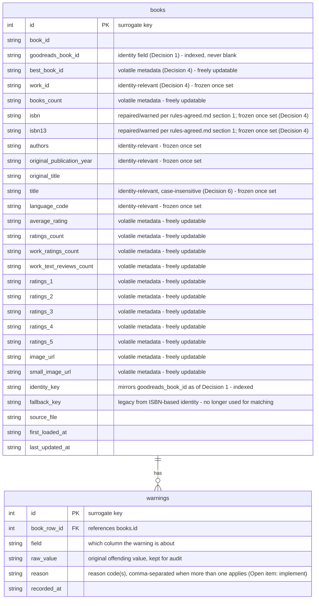

# ERD — agreed schema (Decision 5)

Per [Decision 5](rules-comparison.md): the group adopted **Kristina's
two-table schema** (`books` + `warnings`) as the shared base, with
`goodreads_book_id` added and indexed as the new identity field (Decision
1). This matches the schema already live in
`week3-assignment/books.db`/`ingest.py` as of this update — Anthony and
Abigail still need to update their own database structures to match.

## What changed from the pre-meeting schema

- **`goodreads_book_id` and `identity_key` are now indexed** (added
  directly to `week3-assignment/ingest.py` and the live `books.db`).
- **`identity_key`'s meaning changed**: it used to be the ISBN-13 (derived
  from a valid ISBN-10 when needed). Per Decision 1 it now mirrors
  `goodreads_book_id` — implemented in `ingest.py`'s
  `compute_identity_key()`, and confirmed on a full rebuild of `books.db`
  (all 10,013 rows: `identity_key = goodreads_book_id`).
- **`fallback_key` is now vestigial.** It existed solely to support manual
  review of no-ISBN books under the old ISBN-based identity model (§2 of
  the original `rules.md`). Since every row now has a `goodreads_book_id`,
  there's no "unidentified book" case left for it to help with. It's kept
  in the schema for now rather than dropped unilaterally — worth a quick
  yes/no from the group on whether to remove it.
- **No new tables or columns were added for the skipped open items**
  (publication-year validation, missing-title/author handling, language
  code, the external lookup/correction workflow) — those stay out of
  scope per the Open Items vote in `rules-agreed.md`.

See [`rules-agreed.md`](rules-agreed.md) §2–§3 for exactly which fields are
"volatile metadata" (freely updatable) versus "identity-relevant" (frozen
once set, reject + review on conflict) — the annotations above mirror that
split directly.
